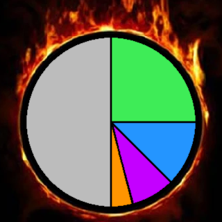

  
Welcome to <b>Quality Hell</b>!

  

___
# Quality Hell

Machines, miners, enemies, asteroids and even your hands have a base quality! Enjoy your time in Quality Hell <3

# Features

* Automatically unlock all available qualities, or start with just the "Uncommon" and "Rare" qualities

* Set a **20%** base quality to all assembling machines, furnaces, and mining drills

* Handcrafting has a **20%** chance to roll for quality

* Nests/Rafts, generated or from an expansion, have **20%*** chance to roll for quality
  * Biters/Pentapods and demolishers have a separate **20%*** chance to roll for quality

* Asteroids have a **20%** chance to roll for a _random_ quality

* Allows quality modules to be inserted **everywhere** (or abide by vanilla rules)

* Discount technologies that only unlock new quality-tiers by **80%**

* Compatible with modded enemies and qualities

* Everything listed here is fully configurable, set anything to "0" to disable it and increase compatibility with other mods!

* Human-made, no AI used!

<small>* Affected by the distance from spawn and by the planets evolution</small>

# Inspired by

This mod draws inspiration from [Everything has Quality](https://mods.factorio.com/mod/quality-everything) (by LuckyLMJ), [Biter Nest Quality!](https://mods.factorio.com/mod/BiterNestQuality) (by trustworhty) and [Quality Asteroids Expanded](https://mods.factorio.com/mod/Quality-Asteroids-Expanded) (by thesixthroc), go check out their mods!

Just note that "Quality Hell" is likely incompatible with "Everything has Quality" and "Biter Nest Quality!". For "Quality Asteroids Expanded" you need to set my "Asteroids quality-chance"-setting to "0".

# Links

* Mod-Page: https://mods.factorio.com/mod/quality-hell
